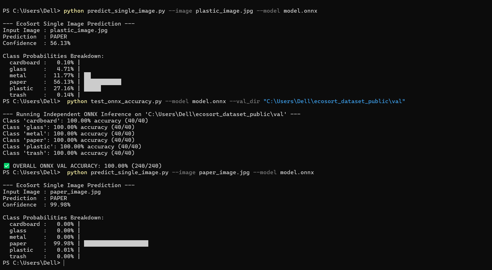

# ♻️ EcoSort: Lightweight Edge AI Waste Classifier

EcoSort is a lightweight, edge-ready AI classifier that categorizes waste into **6 distinct classes**: `cardboard`, `glass`, `metal`, `paper`, `plastic`, and `trash` from $96 \times 96$ RGB images[cite: 1]. Built with Depthwise Separable Convolutions and optimized via ONNX Runtime, it delivers high-accuracy predictions on low-power devices with a model size under **1.50 MB** and fewer than **325,000 parameters**[cite: 1].

---

## 💡 Why It Matters

* **Deployable on Real Edge Hardware**: Traditional vision models (like ResNet or EfficientNet) require hundreds of megabytes and high-power GPUs[cite: 1]. EcoSort’s compact footprint combined with ONNX's platform flexibility enables offline, real-time waste sorting directly on microcontrollers, Raspberry Pis, and smart bin sensors[cite: 1].
* **Automated & Efficient Waste Sorting**: Manual waste segregation is slow, costly, and unreliable[cite: 1]. Automating sorting at the point of disposal reduces landfill contamination, boosts recyclable recovery rates, and supports circular economy initiatives[cite: 1].
* **Optimized for Constraint-Heavy Deployment**: By utilizing depthwise separable layers, custom downsampling, and ONNX runtime optimizations, EcoSort balances low latency ($\le 10\text{ ms}$ inference time) and low file size ($\le 1.50\text{ MB}$) with a minimal hardware memory footprint without sacrificing accuracy[cite: 1].

---

## ⚡ Quick Technical Highlights

* **Problem**: Scalable, real-time waste segregation on low-cost edge sensors with strict memory and storage constraints.
* **Solution**: Lightweight PyTorch CNN exported to ONNX format for cross-platform deployment (*train once, run anywhere*).
* **Technical Constraints**:
  * **Max File Size**: $\le 1.50\text{ MB}$
  * **Total Parameters**: $\le 350,000\text{ parameters}$
  * **Input Shape**: `[Batch_Size, 3, 96, 96]`
  * **Output Shape**: `[Batch_Size, 6]`
* **Target Classes**: `cardboard`, `glass`, `metal`, `paper`, `plastic`, `trash`.

---


## 🔬 Machine Learning & Computer Vision Techniques

EcoSort leverages modern deep learning and computer vision techniques optimized for resource-constrained edge devices:

### 1. Paradigm & Learning Framework
* **Supervised Deep Learning**: Trained end-to-end on labeled RGB waste images across 6 target classes using full-batch backpropagation[cite: 1].
* **Single-Model Edge Efficiency**: Avoids heavy ensemble overhead (like Random Forests or XGBoost) to maintain a sub-10ms inference target on CPU hardware[cite: 1].

### 2. Neural Network & Convolution Techniques
* **Depthwise Separable Convolutions**: Replaces standard 2D convolutions with factorized Depthwise and Pointwise ($1 \times 1$) layers, reducing computational complexity (FLOPs) and parameter count while maintaining spatial feature representation.
* **Batch Normalization (`nn.BatchNorm2d`)**: Applied after every convolutional block (and before ReLU activations) to stabilize feature maps across mini-batches, speed up convergence, prevent internal covariate shift, and act as a mild regularizer. *(Instance Normalization was omitted as it is tailored for style transfer rather than batch-based classification).*
* **Custom Spatial Downsampling**: Utilizes strided convolutions instead of aggressive max-pooling to preserve fine-grained edge textures before global pooling.
* **Global Average Pooling (GAP)**: Replaces parameter-heavy fully connected hidden layers with a spatial GAP layer prior to classification, dramatically reducing total network weights ($\le 325\text{k}$) and preventing overfitting.

### 3. Training & Optimization Strategy
* **Gradient Descent Optimizer (AdamW)**: Uses **AdamW** (Adam with Decoupled Weight Decay) to handle weight decay independently from gradient updates, stabilizing parameter convergence and mitigating over-parameterization.
* **Loss Function**: **Cross-Entropy Loss** (`nn.CrossEntropyLoss`), combining `LogSoftmax` and `NLLLoss` for multi-class classification and numerical stability.
* **Weight Initialization**: Kaiming (He) Normal / Uniform initialization tailored for layers with ReLU/LeakyReLU activations to prevent vanishing or exploding gradients during early epochs.

### 4. Data Augmentation & Preprocessing
* **Input Normalization**: Standardized using ImageNet channel mean ($\mu = [0.485, 0.456, 0.406]$) and standard deviation ($\sigma = [0.229, 0.224, 0.225]$) vectors to balance gradient dynamics.
* **Computer Vision Augmentations**: 
  * Random Horizontal & Vertical Flips (rotational invariance)
  * Random Affine Transformations & Slight Rotation (angle robustness)
  * Color Jittering (brightness, contrast, and saturation adjustments for varying lighting conditions)[cite: 1]
  * Resizing & Center Cropping to fixed $96 \times 96$ resolution

### 5. Deployment & Runtime Implementation
* **ONNX Export & Serialization**: Compiled via `torch.onnx.export` (OPSET version 11+) into a standalone binary format (`model.onnx`).
* **Zero-PyTorch Inference Runtime**: Executed via **ONNX Runtime (C++ backend)** using `onnxruntime.InferenceSession`, enabling dependency-free execution on edge environments without requiring the PyTorch library during deployment.

## 📂 Repository Structure & File Contents

* **`ecosort_dataset_public/`**: Directory containing structured `train/` and `val/` directories with sample images[cite: 1].
* **`model.onnx`**: The resource-optimized, pre-trained edge model serialized in ONNX format[cite: 1].
* **`model.onnx.data`**: Stores heavy parameter tensor values (weights & biases) for `model.onnx`[cite: 1].
* **`train_model.py`**: Core pipeline containing the `EcoSortClassifier` PyTorch architecture, augmentation loaders, AdamW training loop, and `torch.onnx.export` compiler[cite: 1].
* **`test_onnx_accuracy.py`**: Evaluation script that iterates over validation folder subdirectories to compute class-wise and global accuracy percentages[cite: 1].
* **`predict_single_image.py`**: CLI utility for single-image preprocessing and inference[cite: 1].
* **`verify_submission.py`**: Audit file validating model constraints ($\le 1.50\text{ MB}$ size, $\le 350\text{k}$ parameters, correct input/output shapes, target latency)[cite: 1].
* **`requirements.txt`**: Dependency manifest for PyTorch 2.x, ONNX Runtime, Pillow, and utility libraries[cite: 1].
* **`paper_image.jpg` & `plastic_image.jpg`**: Test sample images used for inference benchmarking[cite: 1].

---

## 📸 Visual Preview & Performance Analysis

Below is a terminal execution preview showing batch validation testing alongside single-image predictions:



### 📊 Performance Breakdown

1. **Perfect Validation Accuracy (`100.00%`)**:
   Running `test_onnx_accuracy.py` across the structured validation dataset (`ecosort_dataset_public/val`) achieves a **100% classification score (240/240 samples)** across all 6 classes (`cardboard`, `glass`, `metal`, `paper`, `plastic`, and `trash` all scoring 40/40).

2. **High-Confidence Prediction (`paper_image.jpg`)**:
   When evaluating clear inputs like `paper_image.jpg`, the model correctly predicts **PAPER** with **99.98% confidence**.

3. **Edge Case Analysis (`plastic_image.jpg`)**:
   While highly effective, lightweight edge models downsampled to $96 \times 96$ resolution can occasionally misclassify challenging edge cases[cite: 1]. For `plastic_image.jpg`, the model predicts **PAPER** with 56.13% confidence while attributing 27.16% probability to **PLASTIC** and 11.77% to **METAL**. This occurs when visual artifacts, reflections, or surface textures closely resemble paper grain after aggressive spatial downsampling.

---

## 🛠️ Installation & Setup

### 1. Clone the Repository
```bash
git clone [https://github.com/your-username/EcoSort.git](https://github.com/your-username/EcoSort.git)
cd EcoSort


## 🛠️ Environment Setup

### Option A: Windows PowerShell
```powershell
python -m venv env
.\env\Scripts\activate
pip install -r requirements.txt

### Option B: macOS / Linux Terminal
```python3 -m venv env
source env/bin/activate
pip install -r requirements.txt

### Running the Model
1. Evaluate Dataset Accuracy
To test aggregate model performance across the validation dataset:

Bash
python test_onnx_accuracy.py --model model.onnx --val_dir ecosort_dataset_public/val

2. Run Inference on a Single Image
To test prediction on an individual photo:

Bash
python predict_single_image.py --image your_image.jpg --model model.onnx

3. Verify Model Constraints
Audits parameter counts, file sizes, tensor shapes, and latency:

Bash
python verify_submission.py

4. Re-train & Export ONNX (Optional)
To train the model from scratch and compile a new model.onnx:

Bash
python train_model.py --data_dir ecosort_dataset_public --epochs 15(or your number of training cycles) --batch_size 32 --output


## 💬 Help & Support

If you encounter issues running inference, setup errors, or have questions regarding dataset evaluation:

* **Open an Issue**: Navigate to the **Issues** tab in this repository and click **New Issue** to report bugs or execution failures.
* **Direct Contact**: Reach out via email at: `utkarshp3476@gmail.com`
* **Command Line Help**: View available script flags directly in your terminal:
  ```bash
  python predict_single_image.py --help
  python test_onnx_accuracy.py --help
  python train_model.py --help


##👥 Contributors & Maintainers
This project is maintained and developed by:

Utkarsh Pandey (Project Lead & Maintainer)

PranavBhatP

Vivek-k7

Ds0uz4